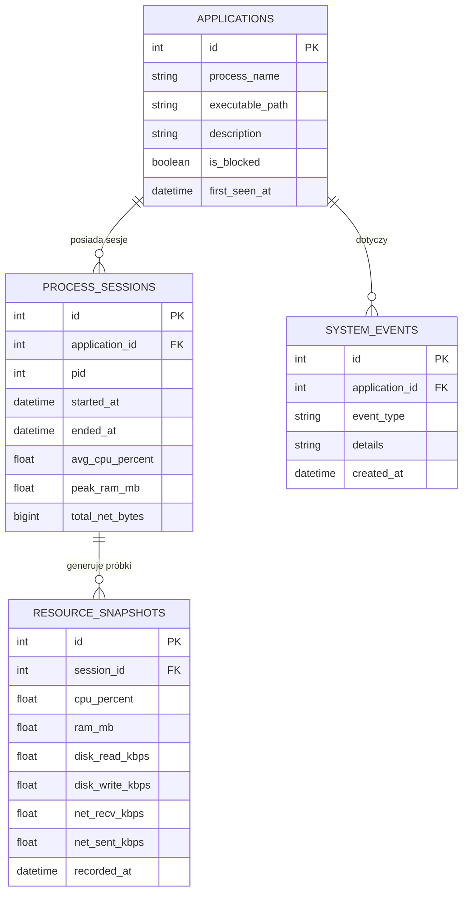

# Architektura lokalnej bazy danych 

Lokalna baza danych dla aplikacji **ProcPilot**. Jej głównym celem jest zapewnienie aplikacji „pamięci historycznej” – gromadzenie danych o uruchomionych procesach, czasie ich działania oraz zużyciu zasobów systemowych w celu generowania statystyk, raportów i analiz wydajności.

## Założenia projektowe
* **Baza w pełni lokalna:** Wykorzystanie silnika **SQLite** (plik lokalny `.db`), co eliminuje konieczność konfiguracji zewnętrznego serwera bazodanowego.
* **Hybrydowy model zapisu danych:** 
  1. Rejestrowanie pełnych **sesji działania procesu** (czas uruchomienia, czas zakończenia, podsumowanie).
  2. Okresowe zapisywanie **próbek telemetrycznych (snapshots)** co określony interwał czasowy (CPU, RAM, Dysk, Sieć) w celu budowy wykresów zużycia zasobów w czasie.
* **Warstwa integracji:** Dostęp do danych realizowany w warstwie `ProcPilot.Infrastructure` przy użyciu **Entity Framework Core**.

---

## Diagram ER (Entity-Relationship)

---

## Opis encji (tabel)

1. **`applications`** *(Katalog aplikacji)*  
   Przechowuje unikalne informacje o programach wykrytych w systemie (nazwa procesu, ścieżka do pliku `.exe`, flaga blokady `is_blocked`). Pozwala grupować wiele uruchomień tego samego programu do zbiorczych raportów (np. łączny czas pracy przeglądarki w ciągu tygodnia).

2. **`process_sessions`** *(Sesje procesów)*  
   Reprezentuje pojedynczy cykl życia procesu od momentu jego uruchomienia (`started_at`) do zamknięcia (`ended_at`). Zawiera zagregowane podsumowanie sesji (średnie zużycie CPU, szczytowe użycie pamięci RAM, całkowity ruch sieciowy), zapisywane finalnie po zakończeniu pracy procesu.

3. **`resource_snapshots`** *(Próbki zużycia zasobów)*  
   Tabela telemetryczna przechowująca cykliczne odczyty wydajności (CPU, RAM, operacje dyskowe I/O, transfer sieciowy) wykonywane w zadanym interwale czasowym. Służy do rysowania wykresów historycznych i analizy obciążenia systemu.

4. **`system_events`** *(Dziennik zdarzeń systemowych)*  
   Rejestr istotnych zdarzeń związanych z zarządzaniem procesami, takich jak próba uruchomienia zablokowanej aplikacji, wymuszone zamknięcie procesu (`Kill`) czy przekroczenie progów alertów.

---

## Planowane indeksy i optymalizacja
Ze względu na częsty zapis próbek w tabeli `resource_snapshots` oraz filtrowanie historii po datach, w kolejnych etapach przewidziano dodanie indeksów na kolumnach `recorded_at`, `started_at` oraz kluczach obcych (`application_id`, `session_id`), a także mechanizmu automatycznego czyszczenia (retencji) najstarszych próbek.